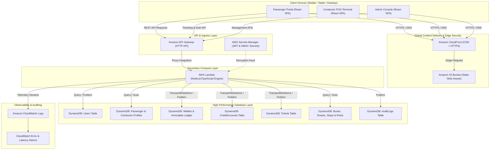
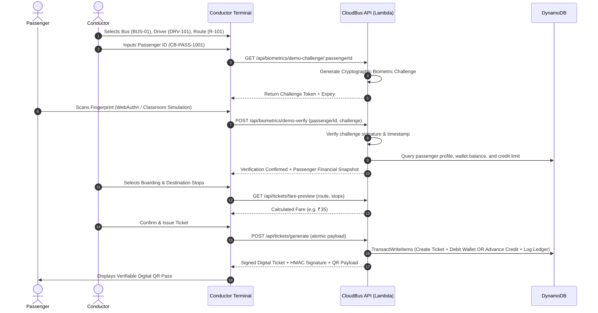

# CloudBus — Cloud Computing Architecture & System Design

## 1. System Overview

**CloudBus — Smart Fingerprint Ticketing & Travel Credit System** is a cloud-native, full-stack transit ticketing platform built using serverless AWS microservices, biometric passkeys (WebAuthn/FIDO2 standard and classroom simulation), role-based access control, digital stored-value wallets, automated verifiable digital ticket issuance, and emergency travel credit.

---

## 2. Cloud Architecture Diagram

---

## 3. AWS Cloud Services Breakdown & Responsibilities

| AWS Service | Architectural Role | Specific Responsibility in CloudBus |
| :--- | :--- | :--- |
| **Amazon S3** | Object Storage | Hosts compiled React static assets (`index.html`, JavaScript bundles, CSS, icons) with strict public access blocks. |
| **Amazon CloudFront** | CDN & Edge Security | Delivers frontend static assets globally over low-latency HTTPS edge nodes, enforcing modern TLS 1.3 encryption. |
| **Amazon API Gateway** | API Management | Exposes HTTP endpoints (`/api/*`), manages CORS, handles TLS termination, request throttling, and payload sizing. |
| **AWS Lambda** | Serverless Compute | Executes backend business logic, JWT session validation, WebAuthn challenge generation/verification, route stop distance calculations, and atomic financial transactions. |
| **Amazon DynamoDB** | NoSQL Data Persistence | High-performance, low-latency persistent database. Uses `TransactWriteItems` to guarantee atomic ticket issuance, wallet deductions, and credit advancements without race conditions. |
| **AWS Secrets Manager** | Secret Configuration | Securely stores JWT signing keys and HMAC ticket signature secrets; resolved automatically at deployment time. |
| **Amazon CloudWatch** | Monitoring & Alerts | Aggregates structured JSON logs, system latency metrics, 5xx error alarms, and security audit events. |
| **AWS IAM** | Identity & Access Mgmt | Enforces least-privilege role policies so the Lambda function can only access its designated DynamoDB tables and CloudWatch log groups. |

---

## 4. Biometric Authentication & Cryptographic Flow

---

## 5. Cost Breakdown & AWS Free Tier Limitations

CloudBus is engineered to run entirely within the **AWS Free Tier**:

| AWS Service | Free Tier Allowance | CloudBus Usage Profile | Estimated Monthly Cost |
| :--- | :--- | :--- | :--- |
| **AWS Lambda** | 1,000,000 requests / month + 3.2M seconds compute | ~100,000 requests/month | **\$0.00** |
| **Amazon DynamoDB** | 25 GB storage + 25 Read / Write Capacity Units | ~1 GB data storage (PAY_PER_REQUEST) | **\$0.00** |
| **Amazon API Gateway** | 1,000,000 HTTP API calls / month (first 12 months) | ~100,000 calls/month | **\$0.00** |
| **Amazon CloudFront** | 1 TB data transfer out / month | ~5 GB data transfer | **\$0.00** |
| **Amazon S3** | 5 GB standard storage + 20,000 GET requests | < 50 MB build assets | **\$0.00** |
| **Amazon CloudWatch** | 5 GB log data ingestion + 10 metrics alarms | ~500 MB log data | **\$0.00** |
| **Total Estimated Run Cost** | | | **\$0.00 / month** (Within Free Tier) |
